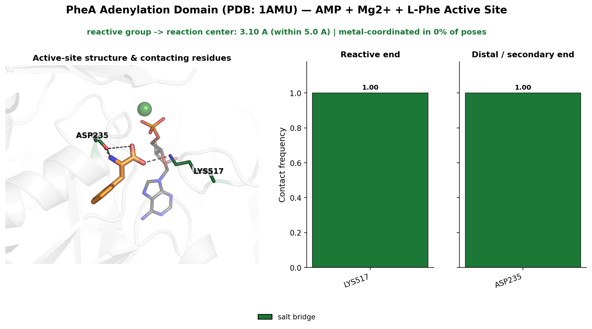
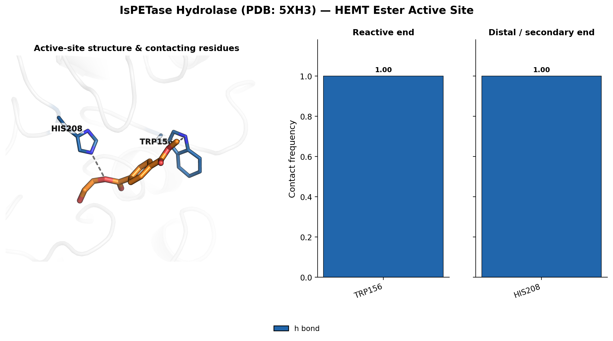

# Enzyme–Substrate Co-Design Toolkit

[](https://github.com/Ray16/enzyme-substrate-codesign/actions/workflows/ci.yml)
[](https://www.python.org/downloads/)
[](LICENSE)

A standalone, mechanism-aware Python toolkit for **saturation mutagenesis**, **partial diffusion**, **Boltz-2 co-folding**, **catalytic geometry evaluation**, and **active-site contact analysis & visualization**.

---

## Quick Start

```bash
git clone https://github.com/Ray16/enzyme-substrate-codesign.git
cd enzyme-substrate-codesign
pip install -e ".[viz]"

# Run the 5-second GPU-free end-to-end demo & test suite
python examples/run_offline_demo.py --out-dir demo_out
pytest -q
```

> **Dependencies:** Core analysis requires only `numpy` and `PyYAML` (Python ≥ 3.10; no Biopython or MDAnalysis needed).
> For live GPU co-folding, install in a dedicated PyTorch/CUDA environment (`pip install -e ".[boltz,viz]"`).
> For ray-traced 3D active-site snapshots, `contact-analysis` auto-detects **PyMOL** (`PYMOL_BIN`, `PATH`, `/opt/anaconda3/envs/pymol/bin/pymol`, or `/Applications/PyMOL.app`) and **UCSF ChimeraX** (`CHIMERAX_BIN`, `PATH`, or `/Applications/ChimeraX*.app`); without either, 2D figures and CSV/Markdown reports still render automatically.

---

## Modules (Inputs & Outputs)

| Module / CLI | Inputs | Outputs | Purpose |
|---|---|---|---|
| `attack_geometry` / `enzyme-geometry` | One or more PDB/mmCIF structures (`.pdb`, `.cif`, `.cif.gz`, `.cif.zst`) + YAML/JSON config (`mechanism`, `geometry`, `thresholds`) | Per-pose & ensemble JSON report (catalytic distance, attack angle, optional dihedral, `extra_metrics`, clash fraction, pass/fail reasons) | Pure-Python structure parser (handles ribose prime atoms & gapped/offset numbering), mechanism-aware geometry scoring, symmetry-aware Kabsch RMSD, and Boltz-2 I/O |
| `boltz_cofold` / `boltz-cofold` | Protein FASTA + YAML/JSON config (`ligands`, optional `partner_chains`, `nucleic_acids`, `protein_modifications`, `constraints`, `boltz`) | Cached MSA CSVs & `index.tsv`; `boltz_inputs/<id>.yaml`; predicted structures & confidence JSONs in `boltz_results/`; QC tables `cofold_verification.csv` & `.json` | Resumable SHA-256 cached MSA retrieval, standard & FP32 serial-capped Boltz-2 batch execution (`skip_existing`), and post-fold sequence/coordinate QC |
| `saturation_mutagenesis` / `saturation-mutagenesis` | Holo scaffold PDB/mmCIF + YAML/JSON config (explicit `positions` or `pocket_cutoff_A`, `alphabet`, `max_mutations`, `ligands`, `mechanism`, `geometry`) | `pocket_positions.csv`, `variants.tsv`, `variants.fasta`, `boltz_inputs/`, `boltz_results/`, `pose_geometry.csv`, `variant_summary.csv`, `top_hits.json` | Whole-complex pocket scan → single/multi-site variant library → Boltz-2 co-folding → mechanism-aware & WT-delta bootstrap ranking |
| `partial_diffusion` / `partial-diffusion` | Parent/motif CIF + YAML/JSON config (`backend`: `rfd4` or `apnovo`, `diffusion`, `ligands`, `geometry`, optional `motif_residues`) | `diffusion_outputs/` (designed CIF/PDBs + `designs.fasta`), `boltz_inputs/`, `boltz_results/`, `pose_geometry.csv`, `design_summary.csv`, `top_hits.json` | Partial diffusion backbone/sequence redesign → unrestrained Boltz-2 refolding → geometry, backbone & catalytic-motif RMSD ranking |
| `contact_analysis` / `contact-analysis` | Pose directory or PDB/mmCIF list (for `report`/`ensemble`), single pose + `target_groups.json` (for `audit`), or `pose_geometry.csv` (for `plot-geometry`) | `<name>_contact_frequency.json`, `<name>_contact_summary.csv`, `<name>_contact_report.md`, `<name>_contact_frequency.png` (PyMOL/ChimeraX 3D + bar chart), `audit.json`, `attack_geometry_summary.png` | Active-site functional-group contact frequencies, strict `heavy_atom_donor_acceptor_v2` audit (sidechain or backbone oxyanion-hole), and publication figures |

---

## Built-In Mechanism Presets

Set `mechanism:` in any YAML config (all thresholds and ranking rules are user-overridable; inspect via `enzyme-geometry --list-mechanisms`):

| Preset | Target Angle | Default `rank_by` | Typical Enzyme Systems |
|---|---|---|---|
| `inline_sn2` | `180°` | `angle_error` | Phosphoryl transfer, adenylation, methyltransfer, haloalkane dehalogenation |
| `carbonyl_addition` | `107°` (Bürgi–Dunitz) | `angle_error` | Serine/cysteine hydrolases, esterases, acyltransferases, proteases |
| `hydride_transfer` | `110°` | `distance` | NAD(P)H / flavin (FAD/FMN) oxidoreductases, ketoreductases |
| `general_acid_base` | distance-only | `distance` | Proton-transfer and general acid/base catalysis |
| `metalloenzyme_coordination` | distance-only (`≤ 2.8 Å`) | `distance` | Inner-sphere Zn²⁺/Fe²⁺/Mn²⁺ metalloenzymes |
| `covalent_catalysis` | distance-only (`≤ 3.5 Å`) | `distance` | PLP aldimine, acyl-enzyme, Schiff-base, heme-thiolate intermediates |
| `custom` | user-defined | user-defined | Any custom reaction geometry or multi-metric scoring |

**Key capabilities across enzyme classes:**
- **Symmetric substrates & stereoselectivity:** Multi-candidate `donor` and `electrophile` selectors, optional 4-atom signed dihedrals (`dihedral_ref` for *Re*/*Si* face), and unlimited named `extra_metrics` (oxyanion hole, catalytic base, metal shell).
- **Oligomers, covalent intermediates & nucleic acids:** Supports `partner_chains` (with `homomer: true` to propagate mutations to identical subunits), `nucleic_acids` (DNA/RNA), `protein_modifications` (PTMs), and Boltz-2 `constraints` (`bond` / `pocket`).
- **Chemical-group contact analysis:** Distinguishes carboxylates vs. esters/lactones, carbonyls vs. hydroxyls, phosphorylated substrates vs. cofactors (ATP/NAD/FAD/heme/PLP/SAM), and supports backbone H-bond auditing.

---

## Example Visualizations

All example figures are generated directly by the toolkit (`python examples/generate_example_figures.py --out-dir docs/images`). The active-site structures below are rendered directly from the bundled public holo crystal structures in `examples/data/`:

### 1. Adenylation Active Site — PheA + AMP + Mg²⁺ + L-Phe (`PDB: 1AMU`, `inline_sn2`)


### 2. Serine Hydrolase Active Site — *Is*PETase + HEMT Ester (`PDB: 5XH3`, `carbonyl_addition`)


### 3. In-Line SN2 Saturation Scan (`inline_sn2`, target 180°)


### 4. Serine Hydrolase Bürgi–Dunitz Scan (`carbonyl_addition`, 85°–130°, target 107°)


---

## Common Workflows

### Saturation Mutagenesis
```bash
saturation-mutagenesis scan-pocket --structure holo.pdb --cutoff 5.0 --output pocket.tsv
saturation-mutagenesis run --config examples/saturation_config.yaml --dry-run
```
See [examples/saturation_config.yaml](examples/saturation_config.yaml) (`inline_sn2`) and [examples/hydrolase_carbonyl_config.yaml](examples/hydrolase_carbonyl_config.yaml) (`carbonyl_addition`).

### Partial Diffusion + Boltz-2 Validation
```bash
partial-diffusion run --config examples/partial_diffusion_config.yaml --dry-run
partial-diffusion evaluate \
  --designs-dir partial_diffusion_out/diffusion_outputs \
  --results-dir partial_diffusion_out/boltz_results \
  --config examples/partial_diffusion_config.yaml \
  --output-dir partial_diffusion_out
```

### Standalone Boltz-2 Co-Folding
```bash
boltz-cofold prepare-msa --fasta candidates.fasta --out-dir msa_out --cache-dir msa_cache
boltz-cofold prepare-inputs --fasta candidates.fasta --config examples/cofold_config.yaml --msa-index msa_out/index.tsv --output-dir cofold_out
boltz-cofold predict --inputs-dir cofold_out/boltz_inputs --results-dir cofold_out/boltz_results --config examples/cofold_config.yaml --fp32
boltz-cofold verify --results-dir cofold_out/boltz_results --fasta candidates.fasta --expected-samples 5 --output-dir cofold_out/qc
```

### Contact Analysis & Geometry Plotting
```bash
contact-analysis report --name my_enzyme --pose-dir boltz_results/my_enzyme --output-dir contact_reports
contact-analysis audit --pose model_0.pdb --target-groups examples/contact_target_groups.json --output audit.json
contact-analysis plot-geometry --pose-geometry-csv saturation_out/pose_geometry.csv --out geometry_summary.png
enzyme-geometry model_0.pdb model_1.pdb --config examples/saturation_config.yaml --output geometry.json
```

### Python API
```python
from saturation_mutagenesis import SaturationConfig, run_saturation_pipeline

cfg = SaturationConfig.from_file("examples/hydrolase_carbonyl_config.yaml")
summary = run_saturation_pipeline(cfg, run_boltz=True)
print(summary["evaluation"]["top_hits"][:5])
```

---

## License

MIT License — see [LICENSE](LICENSE).
