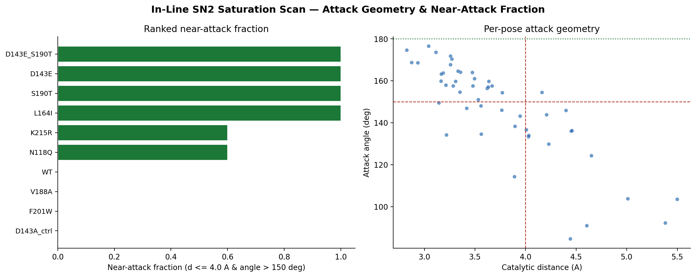
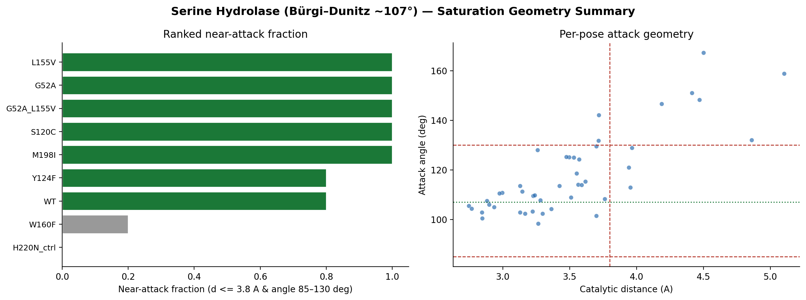
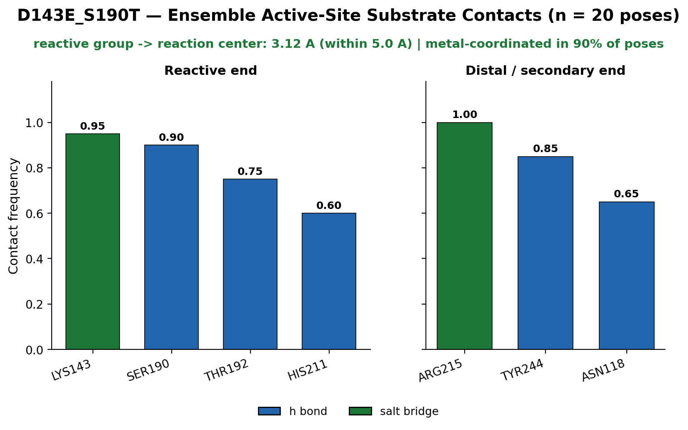

# Enzyme–Substrate Co-Design Workflows

[](https://github.com/Ray16/enzyme-substrate-codesign/actions/workflows/ci.yml)
[](https://www.python.org/downloads/)
[](LICENSE)

Standalone, decoupled Python modules extracted from `Enzyme_agent` (`enzyme_design_agent` and `structural_modeling_agent`) for **saturation mutagenesis**, **partial diffusion**, **Boltz-2 co-folding**, **catalytic attack-geometry evaluation**, and **active-site contact analysis & visualization**.

## Architecture

```text
.
├── attack_geometry/          # Shared PDB/mmCIF parser, nucleophile-electrophile attack geometry,
│                             # proximity-weighted ensembles, Kabsch + ASP OD1/OD2 RMSD, Boltz-2 I/O
├── boltz_cofold/             # Standalone Boltz-2 co-folding: resumable MSA retrieval, standard &
│                             # FP32 serial-capped prediction, and post-fold QC verification
├── saturation_mutagenesis/   # Workflow 1: Whole-complex pocket scan -> single/multi-site variants
│                             # -> Boltz-2 co-folding -> attack-geometry & WT-delta ranking
├── partial_diffusion/        # Workflow 2: Partial diffusion (RFD4-Proteina / AlphaProtein Novo)
│                             # -> Boltz-2 refolding -> geometry + motif/backbone RMSD ranking
├── contact_analysis/         # Active-site substrate contact detection, ensemble frequency tables,
│                             # heavy_atom_donor_acceptor_v2 audit, and PyMOL + Matplotlib figures
├── examples/                 # Configurable YAML/JSON templates for every workflow
└── tests/                    # Offline, GPU-free unit & integration test suite
```

### Mechanism-Aware Catalytic Geometry & Structural Scoring (`attack_geometry/`)

Reaction mechanism is a first-class configuration parameter (`mechanism`) that determines default target geometry, thresholds, ranking criteria, and recommended structural descriptors (all user-overridable):

| Mechanism Preset | Target Angle | Default `rank_by` | Typical Systems |
|---|---|---|---|
| `inline_sn2` | `180°` | `angle_error` | Phosphoryl transfer, adenylation, methyltransfer, haloalkane dehalogenation |
| `carbonyl_addition` | `107°` (Bürgi–Dunitz) | `angle_error` | Serine/cysteine hydrolases, esterases, acyltransferases, proteases |
| `hydride_transfer` | `110°` | `distance` | NAD(P)H / flavin (FAD/FMN) oxidoreductases, ketoreductases |
| `general_acid_base` | distance-only | `distance` | Proton-transfer and general acid/base catalysis |
| `metalloenzyme_coordination` | distance-only (`≤ 2.8 Å`) | `distance` | Inner-sphere Zn²⁺/Fe²⁺/Mn²⁺ metalloenzymes |
| `covalent_catalysis` | distance-only (`≤ 3.5 Å`) | `distance` | PLP aldimine, acyl-enzyme, Schiff-base, heme-thiolate intermediates |
| `custom` | user-defined | user-defined | Any custom reaction geometry or multi-metric scoring |

Inspect all built-in mechanism specifications with `enzyme-geometry --list-mechanisms`.

- **General catalytic descriptors:** Supports single or multi-candidate `donor` and `electrophile` selectors (handling symmetric substrates like diesters/epoxides), optional 3-atom attack angles, optional 4-atom signed dihedrals (`dihedral_ref` for prochiral *Re*/*Si*-face stereoselectivity), and any number of named `extra_metrics` (e.g., oxyanion-hole H-bonds, catalytic-base distances, metal coordination).
- **Oligomeric, covalent, PTM & nucleic-acid Boltz-2 inputs:** Supports `partner_chains` (including `homomer: true` so mutations/designs automatically propagate to identical subunits in homodimers/homotetramers), `nucleic_acids` (DNA/RNA), `protein_modifications` (PTMs), and `constraints` (covalent `bond` / `pocket` restraints), plus resumable `skip_existing` execution and unified `--fp32` support across all workflows.
- **Experimental structure compatibility:** Pure-Python PDB/mmCIF parser handles unquoted ribose/nucleotide prime atoms (`C1'`, `O2'`, `O5'`) and experimental crystal structures with non-1-based numbering or missing internal loops.
- **General symmetry-aware alignment & clash checks:** Proper-rotation Kabsch superposition for backbone and (single- or multi-chain) catalytic-motif RMSD (automatically resolving standard symmetric sidechain atom pairs across ASP, GLU, ARG, PHE, TYR, VAL, LEU) and whole-complex protein–ligand clash screening.
- **Mechanism-aware ensemble statistics & visualization:** Target-angle-aware and distance-only WT bootstrap deltas (`bootstrap_wt_delta`), chemical-group-aware substrate contact analysis (distinguishing carboxylates vs. esters/lactones, carbonyls vs. hydroxyls, phosphorylated substrates vs. cofactors), backbone-capable `heavy_atom_donor_acceptor_v2` auditing, and angle-window / distance-only geometry plotting.
- **Boltz-2 confidence metrics:** Extracts `iptm`, `ligand_iptm`, `complex_plddt`, `complex_iplddt`, `confidence_score`, and directional minimum `pair_chains_iptm` from `confidence_<id>_model_<k>.json`.

---

## Installation & Environment Notes

### Core package (CPU-only analysis, library generation, and dry runs)

```bash
pip install -e .
# With plotting & contact visualization support:
pip install -e ".[viz]"
```

Core dependencies are minimal (`numpy` and `PyYAML`, Python ≥ 3.10). No Biopython or MDAnalysis is required for PDB/mmCIF cofold analysis.

### Boltz-2 co-folding & PyMOL environment

To run live Boltz-2 co-folding predictions, create or activate a dedicated Python/conda GPU environment with PyTorch + CUDA and install the package with the `boltz` and `viz` extras:

```bash
conda create -n boltz python=3.11 -y
conda activate boltz
pip install -e ".[boltz,viz]"
boltz predict --help
```

- For 3D active-site contact snapshots, ensure `pymol` is on your `PATH` (or pass `--pymol-bin /path/to/pymol` / set `PYMOL_BIN`). If PyMOL is unavailable, `contact-analysis` automatically renders the contact-frequency bar chart and Markdown/CSV reports.
- For partial diffusion generation, install **RFD4-Proteina** (`rfd4-generate`) or **AlphaProtein Novo** (`apnovo-run`) in its dedicated environment and set `diffusion.executable` in your YAML config.

---

## Usage Examples

### 1. Standalone Boltz-2 Co-Folding (`boltz-cofold` / `python -m boltz_cofold`)

```bash
# Fetch & cache sequence-specific MSAs (batches <= 101, SHA-256 verified)
boltz-cofold prepare-msa \
  --fasta candidates.fasta \
  --out-dir msa_out \
  --cache-dir msa_cache

# Build Boltz-2 YAML inputs (enzyme + substrate/cofactor ligands)
boltz-cofold prepare-inputs \
  --fasta candidates.fasta \
  --config examples/cofold_config.yaml \
  --msa-index msa_out/index.tsv \
  --output-dir boltz_cofold_out

# Run Boltz-2 predictions (add --fp32 for V100/FP32 serial sample-cap mode, or --dry-run)
boltz-cofold predict \
  --inputs-dir boltz_cofold_out/boltz_inputs \
  --results-dir boltz_cofold_out/boltz_results \
  --config examples/cofold_config.yaml \
  --fp32

# Verify predicted models, sequences, and confidence JSONs
boltz-cofold verify \
  --results-dir boltz_cofold_out/boltz_results \
  --fasta candidates.fasta \
  --expected-samples 5 \
  --output-dir boltz_cofold_out/qc
```

---

### 2. Saturation Mutagenesis (`saturation-mutagenesis` / `python -m saturation_mutagenesis`)

```bash
# Step 1: Identify catalytic pocket residues around the connected holo complex
saturation-mutagenesis scan-pocket \
  --structure holo_scaffold.pdb \
  --cutoff 5.0 \
  --output pocket_positions.tsv

# Step 2: Generate single-site (or multi-site via --max-mutations 2) variants
saturation-mutagenesis generate-variants \
  --structure holo_scaffold.pdb \
  --positions pocket_positions.tsv \
  --label my_enzyme \
  --output-dir saturation_out

# Step 3–5: Prepare Boltz-2 inputs, co-fold, and score/rank variants (or run end-to-end)
saturation-mutagenesis run --config examples/saturation_config.yaml --dry-run
```

**Python API:**

```python
from saturation_mutagenesis import SaturationConfig, run_saturation_pipeline

cfg = SaturationConfig.from_file("examples/saturation_config.yaml")
summary = run_saturation_pipeline(cfg, run_boltz=True)
print(summary["evaluation"]["top_hits"][:5])
```

---

### 3. Partial Diffusion (`partial-diffusion` / `python -m partial_diffusion`)

```bash
# Run partial diffusion (RFD4-Proteina or AlphaProtein Novo) + Boltz-2 refold + ranking
partial-diffusion run --config examples/partial_diffusion_config.yaml --dry-run

# Or score pre-generated designs & Boltz-2 refolds directly:
partial-diffusion evaluate \
  --designs-dir partial_diffusion_out/diffusion_outputs \
  --results-dir partial_diffusion_out/boltz_results \
  --config examples/partial_diffusion_config.yaml \
  --output-dir partial_diffusion_out
```

**Python API:**

```python
from partial_diffusion import PartialDiffusionConfig, run_partial_diffusion_pipeline

cfg = PartialDiffusionConfig.from_file("examples/partial_diffusion_config.yaml")
summary = run_partial_diffusion_pipeline(cfg, run_diffusion=True, run_boltz=True)
print(summary["evaluation"]["top_hits"][:5])
```

---

### 4. Active-Site Contact Analysis & Visualization (`contact-analysis` / `python -m contact_analysis`)

```bash
# End-to-end ensemble contact frequency analysis + CSV/JSON/Markdown report + active-site figure
contact-analysis report \
  --name my_enzyme \
  --pose-dir boltz_results/my_enzyme \
  --output-dir contact_reports

# Run the strict heavy_atom_donor_acceptor_v2 audit (2.4 A quarantine, His/Cys separation)
contact-analysis audit \
  --pose model_0.pdb \
  --target-groups examples/contact_target_groups.json \
  --output contact_audit.json

# Plot ranked near-attack fraction & distance-vs-angle scatter from pose_geometry.csv
contact-analysis plot-geometry \
  --pose-geometry-csv saturation_out/pose_geometry.csv \
  --out saturation_out/attack_geometry_summary.png
```

---

### 5. Standalone Attack-Geometry Evaluation (`enzyme-geometry`)

```bash
enzyme-geometry model_0.pdb model_1.pdb \
  --config examples/saturation_config.yaml \
  --output geometry_report.json
```

---

## Standardized Outputs

- **Saturation mutagenesis:** `variant_summary.csv`, `pose_geometry.csv`, `top_hits.json`
- **Partial diffusion:** `design_summary.csv`, `pose_geometry.csv`, `top_hits.json`
- **Boltz-2 co-folding QC:** `cofold_verification.csv`, `cofold_verification.json`
- **Contact analysis & visualization:** `<name>_contact_frequency.json`, `<name>_contact_summary.csv`, `<name>_contact_report.md`, `<name>_contact_frequency.png`, and `attack_geometry_summary.png`

---

## Example Visualizations

All figures below are generated offline directly by the package's visualization module (`python examples/generate_example_figures.py --out-dir docs/images`):

### In-Line SN2 Saturation Scan (`mechanism: inline_sn2`, target 180°)


### Serine Hydrolase Bürgi–Dunitz Scan (`mechanism: carbonyl_addition`, 85°–130°, target 107°)


### Ensemble Active-Site Substrate Contact Frequencies


---

## Testing & Offline Demo

```bash
# Run the full offline, GPU-free test suite
pytest -q

# Run a 5-second offline end-to-end demo (pocket scan -> mutagenesis -> mock Boltz-2 -> contact analysis -> plots)
python examples/run_offline_demo.py --out-dir demo_out
```

All tests and the offline demo run GPU-free using synthetic holo PDB/mmCIF structures and mock Boltz-2 outputs. See [examples/hydrolase_carbonyl_config.yaml](examples/hydrolase_carbonyl_config.yaml) for a cofactor-free `carbonyl_addition` example and [examples/saturation_config.yaml](examples/saturation_config.yaml) for an `inline_sn2` example.

## License

MIT License — see [LICENSE](LICENSE).
